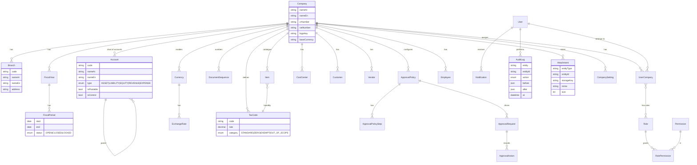
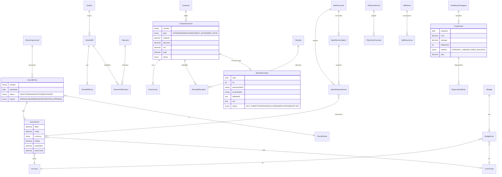
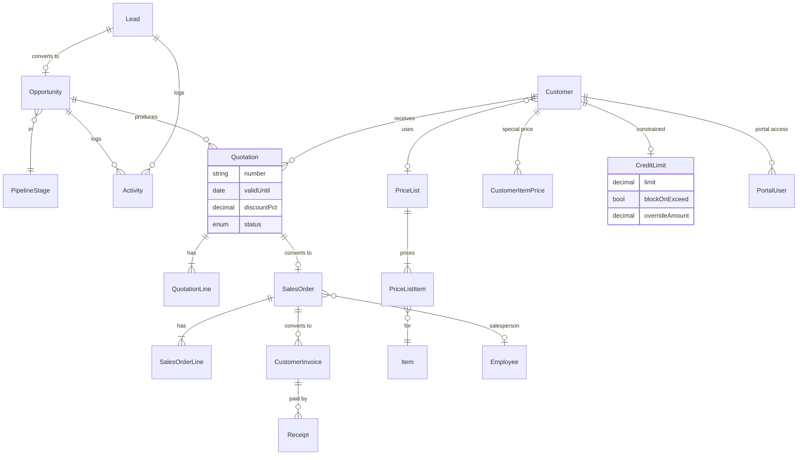
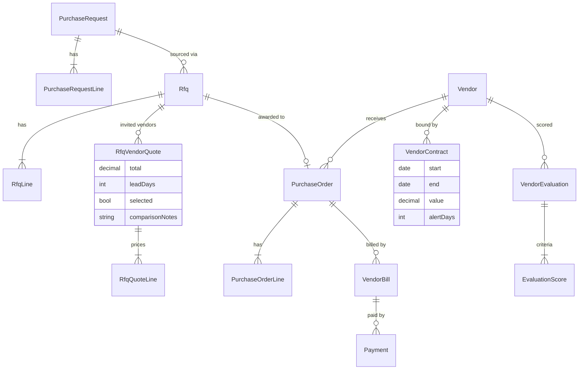
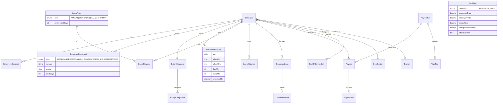

# Safina ERP (سفينة) — Architecture

Company: **The Sailors** · Target: Saudi SMEs, 20–50 staff · Default language: Arabic (RTL), English supported.
Stack: Next.js App Router · TypeScript · Tailwind · shadcn/ui · PostgreSQL + Prisma · NextAuth (credentials) · Zod · TanStack Table · Recharts · next-intl.

> Assumptions made (tell me if wrong): product name "Safina ERP"; target = Saudi SME 20–50 staff; single deployment, multi-company in one database; money stored as `Decimal(18,4)`; dates in UTC, shown in Asia/Riyadh; Hijri date display optional (later).

---

## 1. Folder structure

```
/
├─ ARCHITECTURE.md  PROGRESS.md  .env.example
├─ prisma/
│  ├─ schema.prisma            # split by section comments (single file; Prisma multi-file optional)
│  ├─ migrations/
│  └─ seed.ts                  # 2 companies, COA, 10 cust, 10 vendors, 15 employees, txns
├─ messages/                   # next-intl
│  ├─ ar.json   en.json        # namespaced per module
├─ public/                     # fonts (Noto Naskh/IBM Plex Arabic), logos
├─ src/
│  ├─ app/
│  │  ├─ [locale]/
│  │  │  ├─ (auth)/login, forgot-password
│  │  │  ├─ (app)/             # authenticated shell (sidebar, company/branch switcher)
│  │  │  │  ├─ dashboard/
│  │  │  │  ├─ foundation/     # companies, branches, fiscal, currencies, taxes, users, roles,
│  │  │  │  │                  # audit, numbering, approvals, settings, master data, import
│  │  │  │  ├─ finance/        # gl, journals, ap, ar, bank, assets, vat, zatca, budgets, reports
│  │  │  │  ├─ sales/          # crm, quotations, orders, invoices, receipts, pricing, reports
│  │  │  │  ├─ purchasing/     # requests, rfq, orders, bills, payments, contracts, evaluation
│  │  │  │  ├─ hr/             # employees, attendance, leave, payroll, wps, reports
│  │  │  │  └─ notifications/
│  │  │  └─ (portal)/portal/   # customer portal (separate auth realm: CustomerUser)
│  │  └─ api/
│  │     ├─ auth/[...nextauth]
│  │     ├─ export/[resource]    # Excel export (server, permission checked)
│  │     ├─ pdf/[doc]/[id]       # PDF render
│  │     ├─ attachments/         # upload/download
│  │     └─ cron/                # recurring entries, expiry alerts, depreciation (secured by token)
│  ├─ modules/                  # ← business logic; one folder per bounded module
│  │  ├─ foundation/  finance/  sales/  purchasing/  hr/
│  │  │   each: schema.ts (Zod) · service.ts · queries.ts · actions.ts (server actions)
│  │  │         · components/ · pdf/ · types.ts
│  ├─ core/                     # cross-cutting, no module imports it "upward"
│  │  ├─ auth/        (nextauth config, session, password hashing)
│  │  ├─ rbac/        (permission catalogue, `can()`, `requirePermission()`)
│  │  ├─ tenancy/     (company scoping, Prisma extension)
│  │  ├─ audit/       (Prisma extension writing AuditLog)
│  │  ├─ numbering/   (DocumentSequence allocator, transactional)
│  │  ├─ approvals/   (workflow engine)
│  │  ├─ posting/     (GL posting engine — only way to create JournalLines)
│  │  ├─ notifications/ (in-app + email queue)
│  │  ├─ attachments/ (storage interface: local disk now, S3-compatible later)
│  │  ├─ export/      (Excel), pdf/ (shared header/footer, bilingual labels)
│  │  ├─ import/      (Excel templates + validation)
│  │  └─ zatca/       (TLV/QR, hash, UBL XML, `ZatcaClient` interface + stub)
│  ├─ components/ui/            # shadcn
│  ├─ components/data-table/    # generic TanStack table: search/filter/sort/paginate/columns/export
│  ├─ i18n/ (routing, request config)   ├─ lib/ (prisma, money, dates, hijri, utils)
│  └─ middleware.ts             # locale + auth gate
└─ tests/  (unit for posting, VAT, GOSI, EOSB, depreciation, ZATCA TLV)
```

**Module boundaries (enforced by lint `no-restricted-imports`):**
- `core/*` and `modules/foundation` may not import from finance/sales/purchasing/hr.
- Finance may import foundation + core. Sales, Purchasing, HR may import foundation, core and **finance only through `core/posting` and `modules/finance/public.ts`** (a narrow API: `postJournal`, `getAccountByCode`, `createInvoiceGL`).
- Sales ↔ Purchasing never import each other. HR → finance only via payroll journal posting.
- UI never touches Prisma directly; pages call `queries.ts`, mutations go through `actions.ts` → `service.ts`.

## 2. Cross-cutting design decisions

| Concern | Decision |
|---|---|
| Multi-tenancy | Every business table has `companyId` (and optionally `branchId`). A Prisma client extension injects `companyId IN (user's assigned companies)` on reads and forces `companyId` on writes; the active company comes from the session. Raw SQL is forbidden outside `core/tenancy`. Optional defence-in-depth: Postgres RLS later. |
| Soft delete | `deletedAt`, `deletedById` on all tables; Prisma extension turns `delete` into update and filters `deletedAt: null` on reads. Posted accounting documents are never deleted — they are **reversed**. |
| Audit | Prisma extension captures create/update/delete → `AuditLog(entity, entityId, action, before, after, diff, userId, companyId, ip, at)`. Field-level old → new shown in UI. Append-only. |
| RBAC | Permissions = `module.resource:action` (view/create/edit/approve/delete). `Role` ↔ `RolePermission`; users get roles **per company**. Checked in server actions, API routes and used to hide UI. |
| Auth | NextAuth Credentials, argon2/bcrypt, JWT session carrying userId + allowed company ids; lockout after N failures. Customer portal uses a separate `PortalUser` linked to Customer (read-only own data). |
| Numbering | `DocumentSequence(companyId, docType, fiscalYear, prefix, pattern "{PREFIX}-{YYYY}-{SEQ:4}", next, resetPolicy)`. Allocated with `SELECT … FOR UPDATE` inside the document's transaction (gap-free per policy). |
| Approvals | `ApprovalPolicy(docType, minAmount, maxAmount, steps[])` → `ApprovalRequest` → `ApprovalStep(approverRole/user, status)`. Documents have status `DRAFT → PENDING_APPROVAL → APPROVED → POSTED`. Engine is generic (any entity via `docType + docId`). |
| Money/Currency | `Decimal`; each transaction stores currency, `exchangeRate`, and base-currency amounts. Rounding rules in `lib/money.ts`. Base = SAR. |
| Posting engine | Single service converts documents (invoice, bill, payment, receipt, depreciation, payroll, petty cash) into balanced `JournalEntry` + `JournalLine`s (each with `costCenterId`). Validates open period, balance, account active. Reversal instead of edit once posted. |
| i18n/RTL | next-intl, `ar` default, `dir` set on `<html>`; Tailwind logical utilities (`ms-/me-/ps-/pe-`, `text-start`); every master record has `nameAr` + `nameEn`. PDFs use embedded Arabic font with shaping. |
| Attachments | `Attachment(entityType, entityId, fileName, mime, size, storageKey, sha256)`; storage behind an interface (local `./storage` in dev). |
| Notifications | `Notification` rows (in-app, bell + unread count) and `EmailOutbox` processed by a cron/worker via SMTP. Triggers: approvals, document expiry, contract expiry, low credit etc. |
| Dashboards | `DashboardWidget` registry (code-defined) + per-role layout (`RoleDashboard`). Widgets declare required permission. |
| Lists | One generic `<DataTable>` with server-side search/filter/sort/pagination, column visibility (persisted per user), and "Export Excel" that reuses the same query. |
| Cron jobs | Recurring journals, depreciation runs, expiry alerts (contracts, iqama/passport/etc.), email outbox — exposed as `/api/cron/*` with secret; schedulable by Vercel Cron / OS scheduler. |
| ZATCA | Phase 2 readiness only: UUID, ICV counter, PIH (previous invoice hash chain), SHA-256 hash, TLV Base64 QR (Phase 1 tags 1–5 + Phase 2 tags 6–9), UBL 2.1 XML for standard (B2B) & simplified (B2C). `ZatcaClient` interface with `StubZatcaClient`; real onboarding/CSID/signing/clearance/reporting is **not** implemented. |
| Security | Zod on every input, CSRF via server actions, rate-limit on login, security headers, no secrets in client, permission + tenant check in every service function. |

## 3. Data model (ER overview)

Shown per module for readability. Every table also has `id, companyId (where applicable), createdAt, updatedAt, createdById, updatedById, deletedAt, deletedById` (omitted from diagrams).

### 3.1 Foundation


### 3.2 Finance

Control accounts (AR, AP, VAT input/output, bank, retained earnings, FX gain/loss, depreciation) are configured in `AccountMapping(companyId, key, accountId)`; the posting engine reads keys, never hard-coded codes.

### 3.3 Sales & CRM

Conversion chain stores `sourceDocType/sourceDocId` on each target so quotation → order → invoice → receipt is traceable and one-click.

### 3.4 Purchasing

No goods receipt / stock movement: PO → Bill directly (services & non-stock items only).

### 3.5 HR & Payroll

Rule parameters (GOSI rates, annual/sick leave entitlements, EOSB formula, overtime multiplier 1.5×) live in **effective-dated config tables**, not code, so law changes don't need a deploy. Initial values will follow current Saudi Labour Law / GOSI published rules; **you must have HR/legal verify them** before production use.

### 3.6 Cross-module links
- `Employee` is master data (Foundation) and extended by HR tables; `salesperson` on Sales docs = `Employee`.
- Every posting document → `JournalEntry` via `core/posting`; `JournalEntry.sourceType/sourceId` points back.
- Any document ↔ `Attachment`, `ApprovalRequest`, `AuditLog`, `Notification` via polymorphic `(entityType, entityId)`.

## 4. Build order & deliverables per module
1. **Foundation** — schema, auth, RBAC, tenancy/soft-delete/audit extensions, i18n shell, DataTable, numbering, approvals, attachments, notifications, dashboard framework, settings, master data, Excel import, PDF base.
2. **Finance** — COA mappings, GL/journals, AP/AR + aging, bank/recon/petty cash, fixed assets, VAT return, ZATCA readiness, budgets, statements.
3. **Sales & CRM** → 4. **Purchasing** → 5. **HR & Payroll**.
After each: `npm run build` + `npm run lint` clean, summary + test checklist, PROGRESS.md updated.

## 5. Dependencies
Beyond your list I'd need approval for these (I will not install any until you answer):

| Package | Why |
|---|---|
| `exceljs` | Excel export and import templates |
| `@react-pdf/renderer` | PDF with Arabic font + RTL (alternative: `pdfmake`; avoid headless Chromium for hosting simplicity) |
| `bcryptjs` (or `argon2`) | Password hashing |
| `nodemailer` | Email notifications over SMTP |
| `qrcode` | Render ZATCA TLV QR image |
| `fast-xml-parser` / `xmlbuilder2` | UBL 2.1 XML generation |
| `date-fns` (+ `hijri-converter`, optional) | Dates, Hijri display |
| `react-hook-form` + `@hookform/resolvers` | shadcn forms with Zod |
| `@dnd-kit/core` | CRM kanban drag & drop |
| `vitest` | Unit tests for money/tax/GOSI/EOSB/ZATCA |

## 6. Environment notes
- `.env`: `DATABASE_URL` (session pooler, IPv4), `DIRECT_URL` (for migrations — also pooler-session, since IPv4-only), `NEXTAUTH_SECRET`, `NEXTAUTH_URL`, `SMTP_*`, `CRON_SECRET`, `STORAGE_DIR`.
- Note: this session's sandbox is **Linux/bash**, not Windows. I'll keep scripts cross-platform (npm scripts only, no shell-specific syntax) so they run unchanged in your PowerShell.
- Prisma + Node 24: use current Prisma 6/7 release; I'll verify compatibility when scaffolding.

## 7. Open questions
1. Product name "Safina ERP" OK? 2. Confirm Saudi SME 20–50 staff assumption. 3. Approve dependency list above (or substitute). 4. Hosting target (Vercel vs self-host) — affects file storage and cron. 5. Chart of accounts: seed a standard Saudi/IFRS-style COA — OK? 6. ZATCA: any existing EGS/CSID credentials, or purely readiness for now?
